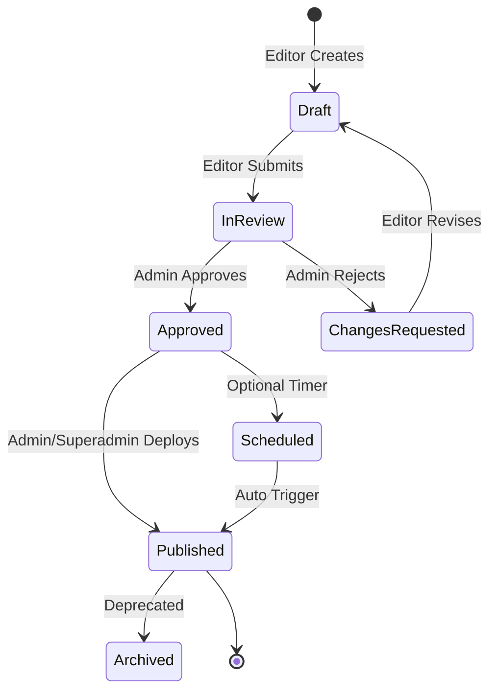

# TrustValue Headless CMS — Production System Architecture

> **Synthesized by Agency Specialist Council**:
> - `engineering-software-architect.md` (Domain Boundaries, Clean Architecture, Portability)
> - `engineering-cms-developer.md` (Content Modeling, Editor UX, Extensible Schema Registry)
> - `engineering-backend-architect.md` (Strapi-style Headless API, Webhook Revalidation)
> - `security-security-architect.md` & `engineering-identity-access-engineer.md` (RBAC, Audit Ledger)
> - `design-ui-designer.md` (Human-centered Editorial Dashboard, Live SERP Preview)

---

## 1. System Topology & Dual-Deployment Model

The TrustValue CMS is designed as a **completely decoupled, independent application** living in `/cms`. It can be run locally alongside the main frontend or deployed independently to a dedicated subdomain (`cms.trustvalue.ai` or `admin.trustvalue.ai`).

```mermaid
flowchart TD
    subgraph ClientLayer [Client & Editor Layer]
        SA[👑 Super Admin]
        AD[🛡️ Admin]
        ED[✍️ Content Editor / Researcher]
    end

    subgraph SubdomainCMS [Standalone CMS Application: cms.trustvalue.ai]
        UI[Modern Editor Dashboard]
        RBAC[RBAC & Governance Chain]
        SEO[Live SEO Engine & SERP Simulator]
        API[Headless REST / GraphQL API Layer]
        STORAGE[Dual-Adapter Engine: File JSON / PostgreSQL]
        HOOK[Webhook & Cache Invalidation Dispatcher]
    end

    subgraph DataStorage [Persistence Layer]
        JSON[Local File Store: /content/sectors, /content/blogs]
        PG[(Production Database: PostgreSQL + pgvector)]
    end

    subgraph MainSite [Public Production Site: trustvalue.ai]
        FE[Next.js 15 App Router]
        ISR[ISR & Edge Cache: Stale-While-Revalidate]
        REV[/api/revalidate Hook]
    end

    SA -->|Full System Config & Role Control| RBAC
    AD -->|Approve & Publish Content| RBAC
    ED -->|Draft & Optimize Content| RBAC
    RBAC --> UI
    UI --> SEO
    UI --> API
    API --> STORAGE
    STORAGE -->|Dev / Staging Mode| JSON
    STORAGE -->|Production Mode| PG
    API -->|Mutation Trigger| HOOK
    HOOK -->|Instant On-Demand Revalidation| REV
    REV -->|Purge Stale Cache Tags| ISR
    FE -->|Read High-Speed Cached Content| ISR
```

---

## 2. The 3-Tier Governance & Editorial Chain (RBAC)

To safeguard editorial integrity, TrustValue CMS implements a strict **Multi-Tier Content Chain**:



### Role Matrix

| Capability | Editor / Researcher | Admin | Super Admin |
| :--- | :---: | :---: | :---: |
| **Draft Blog / Research Post** | ✅ Full Access | ✅ Full Access | ✅ Full Access |
| **Edit Sector Parameters & Meta** | 📝 Propose Changes | ✅ Direct Edit | ✅ Direct Edit |
| **Publish to Live Frontend** | ❌ Requires Review | ✅ One-Click Deploy | ✅ Instant Deploy & Bypass |
| **SEO Meta Overrides & Canonical** | 📝 Assisted Mode | ✅ Direct Edit | ✅ Full Override |
| **Schema Field Definitions** | ❌ Read Only | ❌ Read Only | ✅ Full Schema Designer |
| **API Keys & Webhooks** | ❌ Restricted | ❌ Restricted | ✅ Full Access |
| **User Role Assignment & Audit Ledger** | ❌ Restricted | ❌ Restricted | ✅ Level 0 Access |

---

## 3. Core Content Collections

### 3.1. Sector Collection (`/content/sectors/*.json`)
Manages the taxonomy and auditing rules for industries (Insurance, Banking, Healthcare, Real Estate, etc.):
- **Core Identity**: Name, slug, icon, description, watch invariant note.
- **Hierarchical Taxonomy**: Multi-level category tree with inherited templates and location rules.
- **Auditing Schema**: Configurable attributes (e.g., Claim Settlement Ratio, Waiting Period, Turnaround SLA, Annual Fees).
- **SEO & Search Directives**: Custom title template, meta description, JSON-LD sector graph type, sitemap priority.

### 3.2. Blog & Research Collection (`/content/blogs/*.json`)
Manages long-form consumer guides, circular breakdowns, and investigative audits:
- **Article Metadata**: Title, slug, sector tag, estimated read time, author attribution, publication status.
- **Editorial Content**: Executive summary, lead paragraph, full structured markdown body with callouts and regulatory citations.
- **Deep SEO Suite**:
  - Live Focus Keyword density analyzer.
  - Interactive Google SERP snippet simulation (Desktop & Mobile).
  - OpenGraph / Twitter Card preview.
  - Canonical URL & Robost indexing flags (`index, follow`, `noindex`).

### 3.3. Extensibility Registry & Dynamic Tab Architecture
The CMS uses a **declarative, centralized module registry** (`cms/config/modules.ts`) that decouples navigation and tab routing from UI components:

```ts
// Adding any new tab in the future requires just ONE entry:
{
  id: "disputes",
  label: "Grievance Disputes",
  href: "/dashboard/disputes",
  iconName: "Scale",
  group: "entities",
  badge: "Ombudsman",
  minRole: "editor",
  description: "Track policyholder escalations and legal redressal",
  status: "active",
}
```
When an entry is added to `CMS_MODULES`:
1. **Sidebar Navigation** automatically renders it under its designated group (`content`, `ai`, `entities`, `system`).
2. **RBAC Filtering** enforces access rules (`editor`, `admin`, `superadmin`).
3. **Dashboard Quick Launch** and Command Palettes auto-index the route.

---

## 4. Agency Agents Intelligence Core (`/dashboard/agents`)

The CMS is directly connected to the workspace's **279 specialized autonomous agency agents** in `brain/ai research/agency-agents/`:

```mermaid
flowchart LR
    Editor[✍️ Content Editor] -->|Direct Request| Copilot[Agency AI Assistant Toolbar]
    Copilot --> API[/api/v1/agents/consult]
    API --> Agents[279 Autonomous Agents]
    
    subgraph AgencyAgents [Specialist Divisions]
        A1[engineering-search-relevance-engineer: BM25 & SERP CTR]
        A2[marketing-content-marketer: Direct Answers & Viral Hooks]
        A3[academic-statistician: Claim Ratios & Confidence Intervals]
        A4[specialized-fact-checker: IRDAI / MahaRERA Circulars]
        A5[engineering-ai-engineer: TrustScore ML & Fraud Detection]
    end
    
    Agents --> AgencyAgents
    AgencyAgents -->|Structured JSON Output| API
    API -->|Auto-Populate| Editor
```

### In-Editor Copilot Capabilities:
- **✨ Auto-Generate Schema.org FAQs**: Scans regulatory bodies and outputs compliant Q&As directly into the FAQ repeater.
- **⚡ Synthesize Direct Quick Answer**: Synthesizes a 40-word key takeaway optimized for Google Featured Snippets and AI Overviews.
- **🔍 Optimize SEO Signals**: Suggests high-converting focus keywords, meta descriptions, and calculates BM25 search readiness.
- **🛡️ Statutory Fact Check**: Cross-references citations against statutory acts and gazette notifications.

---

## 5. Headless API Specifications (Strapi-Compatible)

The CMS serves clean JSON endpoints for consumption by the frontend or external microservices:

| Method | Endpoint | Description | Auth Required |
| :--- | :--- | :--- | :--- |
| `POST` | `/api/v1/agents/consult` | Consult any of the 279 Agency Agents for automated research & auditing | Editor+ Bearer Token |
| `GET` | `/api/v1/sectors` | List all audited sectors and meta summaries | Optional / Public API Key |
| `GET` | `/api/v1/sectors/:slug` | Retrieve single sector with category hierarchy & attributes | Optional / Public API Key |
| `PUT` | `/api/v1/sectors/:slug` | Update sector config & trigger frontend revalidation | Admin / Super Admin Bearer Token |
| `GET` | `/api/v1/blogs` | Query blogs with filters (`sector`, `status`, `page`, `limit`) | Optional / Public API Key |
| `POST` | `/api/v1/blogs` | Create a new blog draft | Editor+ Bearer Token |
| `PUT` | `/api/v1/blogs/:slug` | Update blog content, status, or SEO attributes | Editor (Draft) / Admin (Publish) |
| `DELETE`| `/api/v1/blogs/:slug` | Archive or delete post | Admin / Super Admin |
| `POST` | `/api/v1/sync` | Manually dispatch revalidation webhook to main frontend | Admin / Super Admin |
| `GET` | `/api/v1/audit` | Fetch chronological ledger of all content modifications | Super Admin |

---

## 6. Instant Frontend Synchronization (Cache Invalidation Pipeline)

When an editor or admin publishes content in the CMS:
1. The CMS persists the change to the storage adapter (file or PostgreSQL).
2. The CMS dispatches an authenticated HTTP POST payload to `https://trustvalue.ai/api/revalidate`.
3. The main frontend invokes Next.js `revalidateTag('sector-${slug}')` or `revalidateTag('blog-${slug}')`.
4. Stale edge caches update within milliseconds without requiring full site rebuilds.
